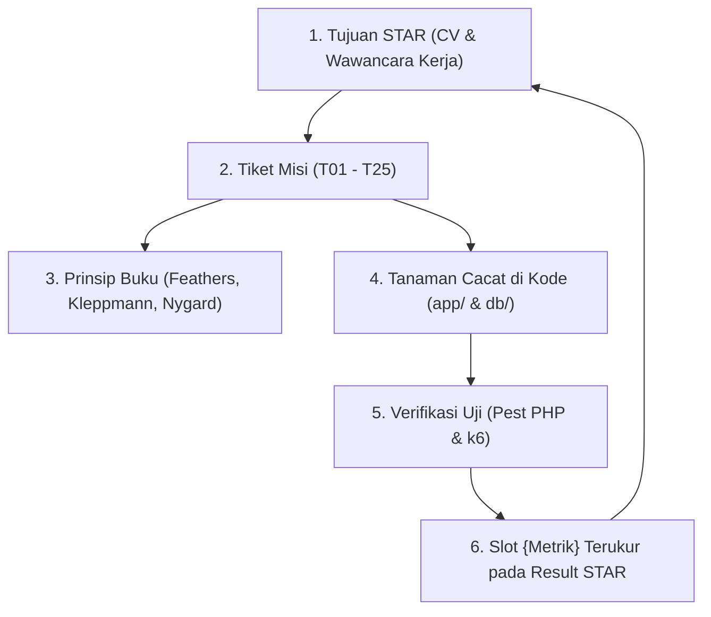
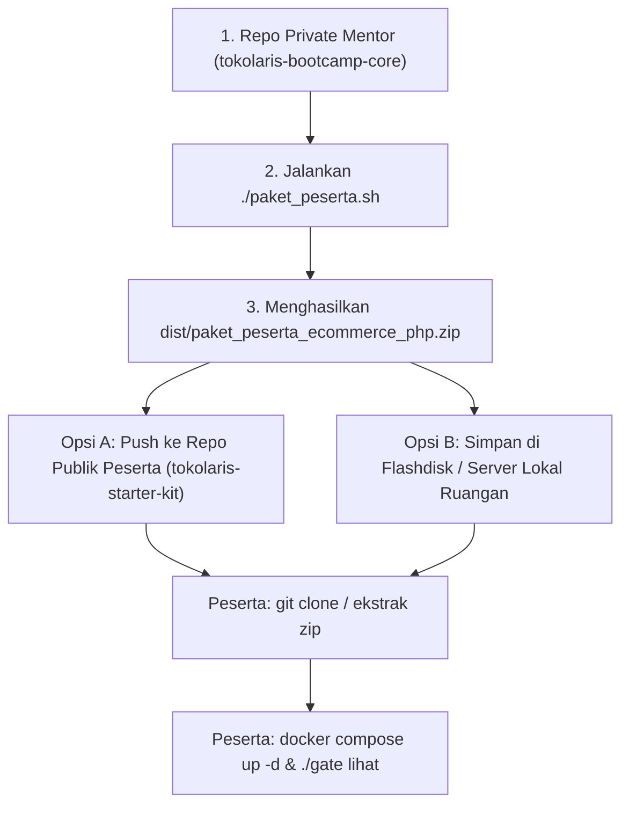

# Spesifikasi Bootcamp Backend Legacy: E-Commerce TokoLaris (16 Jam / 2 Hari)

> Program intensif *developer augmentation* dan *code rescue simulation* untuk talent fresh graduate / junior engineer.  
> **Studi Kasus:** Sistem monolitik warisan e-commerce (*TokoLaris Backend*) berbasis **PHP 8.2 & MySQL 8.0** yang rapuh di bawah beban *high-concurrency*, lambat karena query N+1, memiliki celah keamanan OWASP, dan tanpa automated test. Peserta dituntut menstabilkan sistem dan menyiapkan kampanye **Flash Sale 12.12** tanpa *rewrite* dari nol.

---

## 🔗 1. Rantai Keterkaitan (*Traceability Chain*)

Seluruh elemen kurikulum terhubung dalam satu rantai sebab-akibat yang utuh:

```text
Tujuan STAR (Portofolio) ➔ Tiket Misi ➔ Prinsip Buku ➔ Tanaman Cacat di Kode ➔ Verifikasi Uji ➔ Slot {Metrik} di R
```



---

## 🗂️ 2. Tabel Visibilitas Berkas (Pemisahan Hak Akses)

| Berkas / Direktori | Isi & Deskripsi | Terlihat Oleh |
| :--- | :--- | :--- |
| `panduan/01_spesifikasi_kurikulum.md` | Dokumen master arsitektur, rantai keterkaitan, dan tiket | **Mentor & Penyelenggara** |
| `panduan/02_field_manual_materi.md` | Buku pegangan mandiri 5 modul teknis (*Zero Lecture*) | Peserta, Mentor |
| `panduan/05_40_star_stories.md` | Bank 40 jawaban wawancara berbasis metode STAR | Peserta, Mentor |
| `tiket/00_daftar_tiket.md` | Katalog 25 tiket tantangan + 5 bonus | Peserta, Mentor |
| `tiket/T01_...md` s/d `T25_...md` | Lembar panduan tiket 1 halaman per masalah | Peserta, Mentor |
| `app/` & `db/` & `data/` | Kode sumber monolitik warisan dan seeder data | Peserta, Mentor |
| `skenario/` & `uji/` | Skenario k6 & test assertions (Pest PHP) | Peserta, Mentor |
| `pemeriksa/` (`gate.sh`, `cek_cepat.php`) | CLI lokal peserta untuk pengujian & pelaporan | Peserta, Mentor |
| `kunci/` (`01_T01_...php` s/d `25_T25_...php`) | Kunci jawaban referensi dan patch perbaikan | **Mentor Saja** |
| `papan/` (`01_skema.sql`, `server.php`) | Server backend dan dashboard proyektor ruangan | **Mentor Saja** |

---

## ⚖️ 3. Aturan Main (*Rules of Engagement*)

1. **Format 100% Solo & Hands-on:**
   * Setiap peserta bekerja mandiri di laptop masing-masing via Docker (tanpa pair programming).
   * Tidak ada sesi ceramah/slide presentasi di depan kelas.
2. **Work-In-Progress (WIP) Limit:**
   * Maksimal **2 tiket aktif** secara bersamaan. Tiket baru hanya bisa diambil (`./gate mulai`) jika tiket sebelumnya sudah berstatus lulus atau dikembalikan.
3. **Disiplin Gate Masuk & Keluar:**
   * **Gate Masuk:** Peserta wajib menjalankan test awal untuk melihat kondisi **❌ MERAH** sebelum menyentuh kode.
   * **Gate Keluar:** Tiket dianggap lulus jika test **✅ HIJAU**, tidak ada regresi (`./gate cek`), lolos k6 (khusus tiket performa), dan progres terkirim ke papan (`./gate kirim`).
4. **Skema Penilaian Parsial (Bite-Sized Gamification):**
   * Total Poin Utama: **250 Poin** (10 Mudah $\times$ 5, 10 Sedang $\times$ 10, 5 Sulit $\times$ 20).
   * Tiket dengan 2 assertion test memberikan **50% Poin** jika setengah benar (misal: lolos unit test tapi belum lolos integrasi).
5. **Tiket Bonus (Boss Level):**
   * Tiket `B01–B05` (+25 s/d +35 Poin) hanya terbuka setelah peserta mengumpulkan minimal **100 Poin** tiket wajib.

---

## 🌱 4. Matriks Tanaman Cacat (*The Planted Bugs Matrix*)

Berikut adalah 25 cacat dan anti-pola yang **sengaja ditanam** di dalam kode warisan `app/` dan database `db/`:

| ID Tanaman | Nama Cacat yang Ditanam | Lokasi Berkas di Kode | Tiket Terkait | Akar Masalah & Arah Kunci |
| :---: | :--- | :--- | :---: | :--- |
| **PLANT-01** | Null Pointer pada User Address | `app/Controllers/OrderController.php:32` | `T01` | Nilai `$user['address']` NULL saat dibaca string; atasi via null-coalescing / guard clause. |
| **PLANT-02** | Division by Zero pada Diskon 100% | `app/Services/CartService.php:26` | `T02` | Pembagian `($discount / $finalTotal)` saat final = 0; tangani kasus diskon 100%. |
| **PLANT-03** | State Machine Bypass Pesanan | `app/Controllers/OrderController.php:115` | `T03` | Status 'DELIVERED' bisa di-update ke 'CANCELLED'; pasang validasi transisi status state machine. |
| **PLANT-04** | Race Condition Stok Minus (-28) | `app/Controllers/OrderController.php:44` | `T04` | Pola *Check-Then-Act* di memori PHP; ubah ke *Atomic Conditional Update* di MySQL. |
| **PLANT-05** | Missing Index Foreign Keys | `db/02_index.sql` | `T05` | Tidak ada index pada `orders(user_id)` & `order_items(order_id)`; picu full table scan. |
| **PLANT-06** | N+1 Query pada Daftar Pesanan | `app/Controllers/OrderController.php:82` | `T06` | Query user & items di dalam loop `foreach`; ubah ke batch *Eager Loading* `WHERE IN (...)`. |
| **PLANT-07** | Non-Sargable Date Query | `app/Controllers/ReportController.php:18` | `T07` | Penggunaan `WHERE YEAR(created_at) = 2024` mematikan index; ubah ke sargable range query. |
| **PLANT-08** | Skema Tabel Mengunci (Table Lock) | `db/migrations/add_tracking.sql` | `T08` | `ALTER TABLE` besar saat traffic aktif; terapkan pola 5 fase *Expand-Contract*. |
| **PLANT-09** | Breaking API Contract Payload | `app/Controllers/OrderController.php:60` | `T09` | Mengubah tipe data field lama; pertahankan field lama dan buat field baru berdampingan. |
| **PLANT-10** | Logika Pajak Menumpuk di Controller | `app/Controllers/CheckoutController.php:75` | `T10` | Logika PPN 11% dimasukkan langsung ke controller gemuk; ekstrak via *Sprout Class*. |
| **PLANT-11** | Hardcoded Payment Gateway SDK | `app/Services/CheckoutService.php:40` | `T11` | SDK vendor tertanam paten; bungkus mematuhi `PaymentGatewayInterface` (*Adapter Pattern*). |
| **PLANT-12** | Double-Charge saat Double-Tap | `app/Controllers/OrderController.php:25` | `T12` | Ketiadaan idempotency check; pasang `X-Idempotency-Key` menggunakan Redis `SETNX`. |
| **PLANT-13** | Array Mentah Parameter Email | `app/Services/NotificationService.php:15` | `T13` | Array mentah rawan salah ketik key; transformasikan menjadi *Data Transfer Object (DTO)*. |
| **PLANT-14** | Email Sinkron Memperlambat HTTP | `app/Controllers/OrderController.php:68` | `T14` | Pemanggilan SMTP di thread HTTP; pindahkan payload ke antrean Redis Queue. |
| **PLANT-15** | Render PDF 18 Detik di Thread HTTP | `app/Controllers/OrderController.php:130` | `T15` | FPDF synchronous memicu HTTP 504 Timeout; alihkan pembuatan PDF ke background CLI worker. |
| **PLANT-16** | Unescaped User Input Catatan | `app/Views/invoice_template.php:42` | `T16` | Raw print `<?= $order['notes'] ?>`; pasang sanitasi `htmlspecialchars` konteks HTML. |
| **PLANT-17** | SQL Injection via String Concat | `app/Controllers/SearchController.php:14` | `T17` | `WHERE name LIKE '%$keyword%'`; ubah menjadi *Parameterized Prepared Statement*. |
| **PLANT-18** | IDOR Tanpa Validasi Ownership | `app/Controllers/InvoiceController.php:16` | `T18` | Hanya query `WHERE id = ?`; tambahkan validasi kepemilikan `WHERE id = ? AND user_id = ?`. |
| **PLANT-19** | Password Hash MD5 1 Lapis | `app/Controllers/AuthController.php:21` | `T19` | Pencocokan `md5($pass) === $db_hash`; terapkan algoritma transparan *Rehash-on-Login* (bcrypt). |
| **PLANT-20** | Ketiadaan Safety Net Keranjang | `app/Services/CartService.php:10` | `T20` | Tidak ada test sama sekali; kunci output saat ini menggunakan Pest *Snapshot Testing*. |
| **PLANT-21** | Flaky Test Ketergantungan API Kurir | `tests/Integration/ShippingTest.php:22` | `T21` | Test menembak API kurir nyata; pasang *Test Double (Mock/Stub)* dengan file fixture JSON. |
| **PLANT-22** | Pelanggaran Arsitektur Controller-DB | `app/Controllers/CatalogController.php:30` | `T22` | Controller memanggil raw SQL; pasang aturan *Pest Arch* melarang akses DB langsung. |
| **PLANT-23** | Zombie / Dead Routes Terbengkalai | `public/index.php:55` | `T23` | Route promo musiman 3 tahun lalu masih aktif; eliminasi berdasarkan access log 90 hari. |
| **PLANT-24** | Format Nomor Telepon Acak-Acakan | `database/init.sql:12` | `T24` | Format `0812`, `+628`, `62-812`; tulis script migrasi regex standardisasi E.164. |
| **PLANT-25** | Fatal Type Errors pada Utility | `app/Support/Helpers.php:10` | `T25` | 15 peringatan fatal PHPStan Level 5; tambahkan return type declarations dan null safety. |

---

## 🎯 5. Katalog 25 Tiket & Slot Metrik STAR

Setiap tiket dikalibrasi untuk menghasilkan metrik konkret yang langsung mengisi slot `{...}` pada portofolio **STAR Method** peserta:

| Kode Tiket | Judul Misi Tiket | Acuan Buku Teori | Slot Metrik STAR (Sebelum ➔ Sesudah) | Poin |
| :---: | :--- | :--- | :--- | :---: |
| **T01** | Fix Null Pointer Exception Alamat | *Working Effectively with Legacy Code* | `{fatal_error_rate}`: 4% ➔ **0%** | 5 |
| **T02** | Fix Division by Zero Diskon 100% | *Why Programs Fail* | `{error_500_promo}`: 12 komplain ➔ **0** | 5 |
| **T03** | Fix State Machine Bypass Pembatalan | *Domain-Driven Design Reference* | `{illegal_state_change}`: rentan ➔ **0** | 10 |
| **T04** | Fix Race Condition Stok Flash Sale | *Designing Data-Intensive Applications* (Bab 7) | `{stok_akhir}`: -28 ➔ **0 mutlak**; `{oversold}`: 28 ➔ **0** | 20 |
| **T05** | Missing Index Foreign Keys | *SQL Antipatterns* (Bab Index Shotgun) | `{scan_type}`: ALL ➔ **ref / eq_ref** | 5 |
| **T06** | Eliminasi N+1 Query Riwayat Order | *High Performance MySQL* | `{query_count}`: 152 ➔ **3 query**; `{latensi}`: 4.8s ➔ **140ms** | 10 |
| **T07** | Optimasi Query Sargable Date Range | *SQL Antipatterns* | `{durasi_rekap}`: 18 detik ➔ **42 milidetik** | 10 |
| **T08** | Migrasi Skema Expand-Contract | *Refactoring Databases* (Ambler & Sadalage) | `{downtime_migrasi}`: 15 menit ➔ **0 detik** | 20 |
| **T09** | Backward Compatibility Field API | *API Design Patterns* | `{mobile_crash_rate}`: 35% ➔ **0%** | 5 |
| **T10** | Kalkulasi Pajak via Sprout Class | *Working Effectively with Legacy Code* (Bab 6) | `{regression_risk}`: tinggi ➔ **terisolasi 100% test** | 10 |
| **T11** | Adapter Pattern Payment Gateway | *Design Patterns (GoF)* / Feathers | `{coupling_factor}`: tight ➔ **decoupled via interface** | 10 |
| **T12** | Proteksi Idempotency Key via Redis | *Enterprise Integration Patterns* | `{double_charge_complaint}`: 25/bulan ➔ **0** | 20 |
| **T13** | Ekstraksi Payload Email ke DTO | *Refactoring (Martin Fowler)* | `{type_safety}`: array mentah ➔ **strict DTO class** | 5 |
| **T14** | Pemisahan Kirim Email ke Redis Queue | *Release It!* (Stability Patterns) | `{checkout_latency}`: 3.2s ➔ **180ms** | 10 |
| **T15** | Offload PDF Invoice ke Async Worker | *Release It!* (Thread Pool Starvation) | `{http_504_timeout}`: 100% under load ➔ **0%** | 20 |
| **T16** | Sanitasi XSS Catatan Pesanan | *Web Application Security (Andrew Hoffman)* | `{xss_payload_execution}`: lolos ➔ **escaped 100%** | 5 |
| **T17** | Tutup Celah SQL Injection Pencarian | *OWASP Top 10 Guidelines* | `{sqli_leakage}`: seluruh DB ➔ **0 leak (Prepared)** | 10 |
| **T18** | Proteksi IDOR Akses File Invoice | *Alice and Bob Learn Application Security* | `{idor_cross_account_access}`: tembus ➔ **403 Forbidden** | 10 |
| **T19** | Rehash-on-Login Password MD5 | *Threat Modeling: Designing for Security* | `{migrated_passwords}`: 0% ➔ **85% dalam 90 hari** | 20 |
| **T20** | Snapshot Test Pertama Keranjang | *Working Effectively with Legacy Code* (Bab 13) | `{safety_net_coverage}`: 0% ➔ **15 skenario terkunci** | 5 |
| **T21** | Mocking External HTTP API Kurir | *Unit Testing Principles (Vladimir Khorikov)* | `{flaky_ci_rate}`: 40% gagal palsu ➔ **100% hijau** | 10 |
| **T22** | Architecture Testing (Pest Arch) | *Software Architecture: The Hard Parts* | `{architectural_violations}`: 18 ➔ **0 pelanggaran** | 10 |
| **T23** | Eliminasi 5 Dead Routes Berdasarkan Log | *Software Engineering at Google (Deprecation)* | `{codebase_size}`: terpangkas 1.200 baris kode mati | 5 |
| **T24** | Standardisasi Format Telepon E.164 | *Database Reliability Engineering* | `{otp_delivery_success}`: 82% ➔ **99.4%** | 5 |
| **T25** | Perbaiki 15 Fatal Error PHPStan | *PHPStan Static Analysis Engine* | `{phpstan_errors}`: 47 ➔ **0 pada Level 6** | 10 |

---

## 🌟 6. Matriks 5 Tiket Bonus (*Boss Level*)

| Kode | Gelar / Kategori | Skenario Masalah | Acuan Buku & Konsep | Poin |
| :---: | :--- | :--- | :--- | :---: |
| **B01** | 🛡️ Resilience | Timeout 30s pada API eksternal melumpuhkan web server | *Release It!* — **Circuit Breaker Pattern** | +30 |
| **B02** | 🌐 Distributed | Dual-Write hazard memicu notifikasi hilang saat commit | *Designing Data-Intensive Apps* — **Outbox Pattern** | +35 |
| **B03** | 🤖 Automation | 50 file warisan harus diperbarui sintaksnya secara massal | *Software Engineering at Google* — **Rector AST Codemod** | +25 |
| **B04** | 🧪 Test Rigor | Test suite coverage tinggi tapi tidak menangkap mutasi | *Unit Testing (Khorikov)* — **Infection Mutation MSI $\ge 85\%$** | +25 |
| **B05** | ⚖️ Scaling | CPU DB Master 95% akibat query SELECT membebani penulisan | *Database Reliability Engineering* — **Read-Write Splitting** | +30 |

---

## 📦 7. Alur Distribusi Paket ke Peserta

Untuk menjaga keamanan kunci jawaban dan kenyamanan peserta:



1. **Penyelenggara** menjaga repo master privat (folder `kunci/` dan `papan/` tidak pernah dibagikan mentah).
2. Menjalankan `./paket_peserta.sh` untuk menyaring hanya berkas peserta (`app/`, `db/`, `data/`, `tiket/`, `pemeriksa/`, `peserta/`, `skenario/`, `uji/`, `panduan/`).
3. Paket didistribusikan via **GitHub Starter-Kit Publik** atau **Flashdisk USB Lokal** di ruangan tatap muka.
