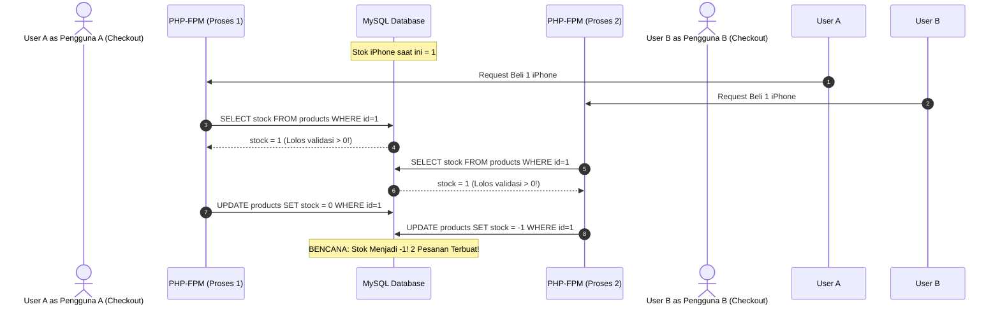
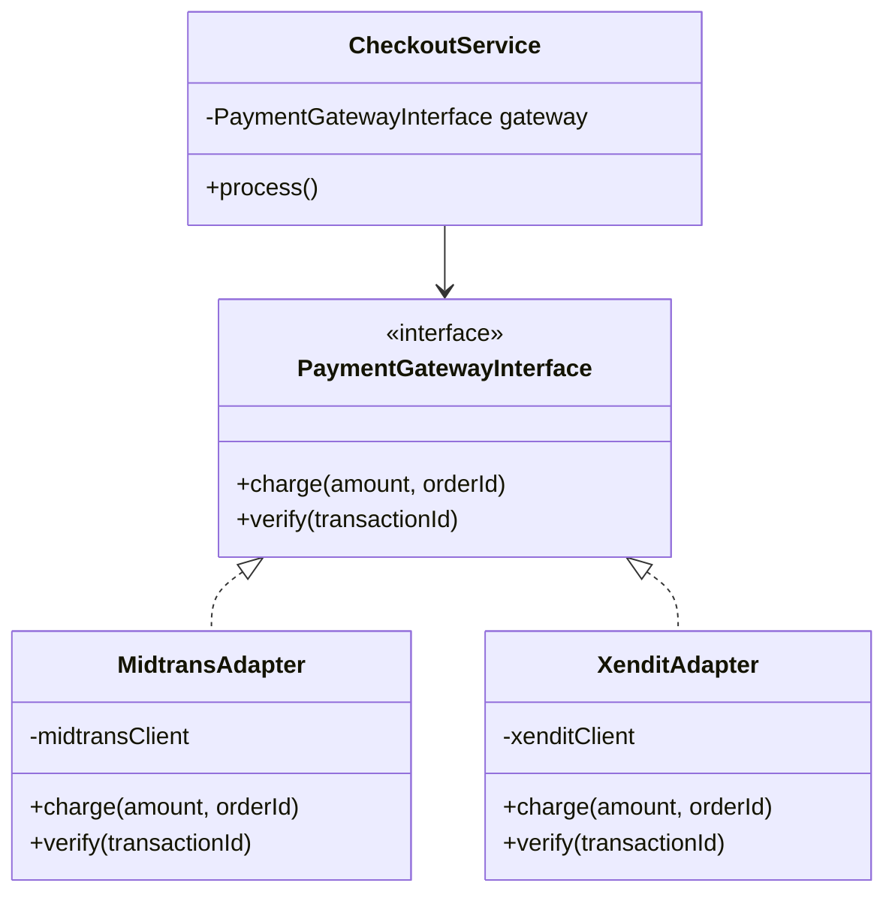
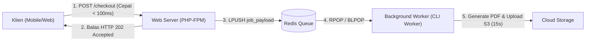

# 📖 The Engineer's Field Manual: Panduan Teknis Lengkap Legacy Backend
> **Buku Pegangan Mandiri Peserta:** Materi fundamental, mekanisme internal komputer/database, anti-pattern warisan, dan solusi kode modern untuk menaklukkan sistem backend legacy.

---

## 📑 Daftar Isi Modul Pembelajaran

- [Modul 1: Concurrency, Race Conditions & Database Locking](#modul-1-concurrency-race-conditions--database-locking)
- [Modul 2: Database Performance, Indexing & Masalah N+1 Query](#modul-2-database-performance-indexing--masalah-n1-query)
- [Modul 3: Seam Theory, Safe Refactoring & Design Patterns](#modul-3-seam-theory-safe-refactoring--design-patterns)
- [Modul 4: Asynchronous Offloading, Redis Queues & Idempotency](#modul-4-asynchronous-offloading-redis-queues--idempotency)
- [Modul 5: Keamanan Praktis & Migrasi Data Tanpa Downtime](#modul-5-keamanan-praktis--migrasi-data-tanpa-downtime)

---

## Modul 1: Concurrency, Race Conditions & Database Locking

> **Relevansi Tiket:** `TKT-04` (Stok Minus Flash Sale), `TKT-03` (State Machine Bypass), `TKT-12` (Double-Tap)

### 1.1 Apa Sebenarnya *Race Condition* Itu?
Di lingkungan produksi, web server (seperti PHP-FPM atau Nginx) melayani request pengguna secara **paralel** di thread/proses yang terpisah dan terisolasi. 

Jika dua request membaca data yang sama pada milidetik yang sama, keduanya akan melihat state lama yang identik sebelum sempat disimpan ke database.



---

### 1.2 Kode Anti-Pattern (Penyebab Stok Minus):
```php
// ❌ KODE RUSAK WARISAN (Check-Then-Act di Memori PHP):
$product = $db->query("SELECT * FROM products WHERE id = ?", [$productId])->fetch();

if ($product['stock'] >= $qty) {
    // BUG FATAL: Jeda waktu antara SELECT dan UPDATE memungkinkan 
    // 50 request lain membaca nilai stock yang sama!
    $newStock = $product['stock'] - $qty;
    $db->query("UPDATE products SET stock = ? WHERE id = ?", [$newStock, $productId]);
    createOrder($userId, $productId, $qty);
} else {
    throw new Exception("Stok habis");
}
```

---

### 1.3 Solusi 1: Atomic Database Update (Paling Cepat & Direkomendasikan)
Database engine (seperti MySQL InnoDB) memiliki mekanisme penguncian baris (*row lock*) bawaan saat mengeksekusi operasi `UPDATE`. Kita dapat memindahkan operasi matematika ke dalam satu instruksi atomik SQL:

```php
// ✅ SOLUSI MODERN: Atomic Conditional Update
$affected = $db->execute(
    "UPDATE products 
     SET stock = stock - ? 
     WHERE id = ? AND stock >= ?",
    [$qty, $productId, $qty]
);

// MySQL menjamin hanya transaksi yang berhasil mengunci dan memenuhi 
// syarat `stock >= ?` yang akan menghasilkan affected rows = 1.
if ($affected === 1) {
    createOrder($userId, $productId, $qty);
    return response(['status' => 'success']);
}

// Jika affected rows = 0, berarti stok sudah habis direbut user lain!
return response(['status' => 'error', 'message' => 'Stok habis'], 400);
```

---

### 1.4 Solusi 2: Pessimistic Locking (`SELECT ... FOR UPDATE`)
Jika alur bisnis memerlukan pengecekan kompleks sebelum mengupdate:
```php
// ✅ SOLUSI ALTERNATIF: Pessimistic Lock dalam Database Transaction
$db->beginTransaction();
try {
    // Baris produk ini di-lock total. Request lain harus ANTRI sampai transaksi selesai!
    $product = $db->query(
        "SELECT * FROM products WHERE id = ? FOR UPDATE", 
        [$productId]
    )->fetch();

    if ($product['stock'] < $qty) {
        $db->rollBack();
        return response(['message' => 'Stok habis'], 400);
    }

    $db->execute("UPDATE products SET stock = stock - ? WHERE id = ?", [$qty, $productId]);
    createOrder($userId, $productId, $qty);
    $db->commit();
} catch (Exception $e) {
    $db->rollBack();
    throw $e;
}
```

---

## Modul 2: Database Performance, Indexing & Masalah N+1 Query

> **Relevansi Tiket:** `TKT-05` (Missing Index), `TKT-06` (N+1 Query), `TKT-07` (Sargable Query)

### 2.1 Memahami Struktur Index B-Tree
Database tanpa index bekerja seperti buku 1.000 halaman tanpa daftar isi. Untuk mencari kata tertentu, database harus membaca setiap halaman dari awal sampai akhir (**Full Table Scan** / `type: ALL`).

Index B-Tree menyimpan data dalam struktur pohon hierarkis berurut:
* Kompleksitas pencarian: dari $\mathcal{O}(N)$ menjadi $\mathcal{O}(\log N)$.
* Pada tabel 1.000.000 baris, pencarian tanpa index butuh **1.000.000 operasi baca**.
* Dengan B-Tree index, pencarian selesai dalam maksimal **20 operasi baca**!

---

### 2.2 Analisis Query Plan dengan `EXPLAIN`
Jalankan `EXPLAIN` di depan query SQL untuk melihat cara kerja database engine:
```sql
EXPLAIN SELECT * FROM orders WHERE user_id = 42;
```
* **Waspadai kolom `type`:**
  * ❌ `ALL`: Full Table Scan (Database membaca seluruh tabel dari baris 1 s/d jutaan). Wajib diperbaiki!
  * 🟡 `index`: Full Index Scan (Membaca seluruh pohon index).
  * ✅ `range`: Membaca sebagian index (bagus untuk query tanggal/angka).
  * 🚀 `ref` atau `eq_ref`: Pencarian tepat sasaran menggunakan B-Tree (Sangat cepat!).

---

### 2.3 Aturan "Sargable Query" (Search Argument Able)
Banyak developer membuat query yang mematikan index B-Tree tanpa disadari karena membungkus kolom dalam fungsi:

```sql
-- ❌ QUERY BURUK (Non-Sargable): Index pada kolom `created_at` DIABAIKAN oleh MySQL!
SELECT * FROM orders WHERE YEAR(created_at) = 2024;

-- ✅ QUERY MODERN (Sargable): Menggunakan rentang nilai langsung, Index terbaca sempurna!
SELECT * FROM orders 
WHERE created_at >= '2024-01-01 00:00:00' 
  AND created_at < '2025-01-01 00:00:00';
```

---

### 2.4 Menjinakkan Masalah N+1 Query
Masalah N+1 terjadi saat ORM melakukan query tambahan di dalam looping:

```php
// ❌ KODE RUSAK (1 Query untuk order + 20 Query untuk user + 20 Query untuk toko = 41 Query!)
$orders = Order::limit(20)->get(); // 1 Query
foreach ($orders as $order) {
    echo $order->user->name;       // Memicu 1 Query baru per baris!
    echo $order->store->name;      // Memicu 1 Query baru per baris!
}

// ✅ SOLUSI MODERN: Batch Eager Loading (Hanya 3 Query Total!)
// Query 1: SELECT * FROM orders LIMIT 20;
// Query 2: SELECT * FROM users WHERE id IN (1, 4, 9, ...);
// Query 3: SELECT * FROM stores WHERE id IN (2, 8, ...);
$orders = Order::with(['user', 'store'])->limit(20)->get();
```

---

## Modul 3: Seam Theory, Safe Refactoring & Design Patterns

> **Relevansi Tiket:** `TKT-09` (Backward Compatibility), `TKT-10` (Sprout Class), `TKT-11` (Adapter Pattern)

### 3.1 Teori "Seam" (Titik Sambung) — Michael Feathers
> **Definisi:** *Seam* adalah tempat di dalam basis kode di mana kamu dapat mengubah perilaku program tanpa perlu mengedit kode sumber aslinya.

Saat menghadapi file legacy 2.000 baris yang rapuh dan menakutkan, **JANGAN melakukan refactor massal**. Gunakan 2 teknik pembedahan aman:

---

### 3.2 Teknik 1: Sprout Method / Sprout Class
Jika kamu harus menambahkan aturan validasi atau kalkulasi baru ke dalam fungsi legacy yang kusut:
1. Buat kelas/fungsi baru terpisah (*Sprout*).
2. Tulis automated unit test 100% untuk kelas baru tersebut.
3. Panggil kelas baru tersebut hanya lewat satu baris sambungan di kode lama.

```php
// ✅ KELAS BARU TERISOLASI (Diuji penuh dengan Unit Test):
class TaxCalculator2024 {
    public function calculate(float $subtotal, string $customerType): float {
        if ($customerType === 'B2B') return $subtotal * 0.11;
        return $subtotal > 500000 ? $subtotal * 0.11 : 0.0;
    }
}

// DI KONTROLLER LAMA 2.000 BARIS (Hanya menyisipkan 1 baris sambungan):
public function checkoutLegacyMethod() {
    // ... 500 baris kode lama ...
    
    // Titik sambung (Seam):
    $tax = (new TaxCalculator2024())->calculate($orderTotal, $user->type);
    
    // ... 500 baris kode lama berikutnya ...
}
```

---

### 3.3 Teknik 2: Adapter Pattern untuk Third-Party Services
Saat mengintegrasikan payment gateway atau kurir baru, jangan masukkan SDK mereka langsung ke controller! Bungkus dalam satu kontrak interface:



```php
// 1. Definisikan Kontrak Bersama
interface PaymentGatewayInterface {
    public function charge(float $amount, string $orderId): array;
}

// 2. Adapter untuk Vendor Baru
class XenditPaymentAdapter implements PaymentGatewayInterface {
    public function charge(float $amount, string $orderId): array {
        // Panggil SDK Xendit di sini
        return ['status' => 'PENDING', 'reference_id' => 'XEN-123'];
    }
}
```

---

## Modul 4: Asynchronous Offloading, Redis Queues & Idempotency

> **Relevansi Tiket:** `TKT-12` (Idempotency Key), `TKT-14` (Email Queue), `TKT-15` (PDF Worker)

### 4.1 Mengapa Operasi Berat Membunuh Web Server?
PHP-FPM memiliki jumlah worker terbatas (misal: 20 worker proses).
* Jika satu request cetak PDF invoice memakan waktu **15 detik**, maka 20 orang yang mencetak invoice bersamaan akan menyedot seluruh worker pool.
* Akibatnya: Pengguna lain yang hanya ingin membuka halaman utama akan terkena **HTTP 504 Gateway Timeout**.

---

### 4.2 Pola Asynchronous Queue (Producer-Consumer)
Ubah alur pemrosesan dari blocking synchronous menjadi decoupled:



---

### 4.3 Idempotency Key (Mencegah Eksekusi Transaksi Ganda)
Koneksi internet mobile yang buruk sering membuat user menekan tombol bayar 2 kali (*double-tap*) atau aplikasi mobile melakukan *auto-retry* saat layar loading.

Backend wajib menerapkan **Idempotent Consumer** menggunakan Redis atomic operation `SETNX`:

```php
// Endpoint Checkout
$idempotencyKey = $request->header('X-Idempotency-Key');

// SETNX (Set if Not Exists) dengan waktu kedaluwarsa 120 detik
$isNewRequest = $redis->set("idemp:{$idempotencyKey}", "PROCESSING", ['NX', 'EX' => 120]);

if (!$isNewRequest) {
    // Request dengan Key ini sudah sedang diproses atau pernah sukses!
    return response([
        'status' => 'error', 
        'message' => 'Transaksi sedang diproses. Mohon tunggu.'
    ], 409); // 409 Conflict
}

try {
    $result = processOrderPayment($request->payload());
    $redis->set("idemp:{$idempotencyKey}", json_encode($result), ['EX' => 86400]);
    return response($result);
} catch (Exception $e) {
    $redis->del("idemp:{$idempotencyKey}"); // Lepas kunci jika gagal
    throw $e;
}
```

---

## Modul 5: Keamanan Praktis & Migrasi Data Tanpa Downtime

> **Relevansi Tiket:** `TKT-08` (Expand-Contract), `TKT-17` (SQLi), `TKT-18` (IDOR), `TKT-19` (Rehash-on-Login)

### 5.1 Remediasi SQL Injection: Prepared Statements
SQL Injection terjadi ketika data dari user digabungkan langsung (*string concatenation*) ke dalam query SQL:

```php
// ❌ KODE RENTAN (SQL Injection):
// Jika input: "' OR '1'='1" -> Seluruh data bocor!
$sql = "SELECT * FROM products WHERE name LIKE '%" . $_GET['search'] . "%'";
$db->query($sql);

// ✅ KODE AMAN (Parameterized Query / Prepared Statement):
// Database engine memisahkan tahap parsing logika SQL dengan tahap pengisian data string.
$stmt = $pdo->prepare("SELECT * FROM products WHERE name LIKE :search");
$stmt->execute(['search' => '%' . $_GET['search'] . '%']);
$products = $stmt->fetchAll();
```

---

### 5.2 Menutup Celah IDOR (Insecure Direct Object Reference)
IDOR terjadi ketika sistem mempercayai ID dari parameter URL tanpa memvalidasi hak milik user yang sedang login:

```php
// ❌ KODE RENTAN IDOR (Siapapun bisa download invoice orang lain):
public function downloadInvoice(Request $request) {
    $invoiceId = $request->query('id'); // misal: ?id=1042
    return Invoice::find($invoiceId)->downloadPdf();
}

// ✅ KODE AMAN (Enforce Authorization Context):
public function downloadInvoice(Request $request) {
    $invoiceId = $request->query('id');
    $currentUser = auth()->user();

    $invoice = Invoice::where('id', $invoiceId)
                      ->where('user_id', $currentUser->id)
                      ->first();

    if (!$invoice) {
        // Kembalikan 403 atau 404 agar penyerang tidak tahu ID tersebut ada
        return response(['message' => 'Invoice tidak ditemukan'], 404);
    }

    return $invoice->downloadPdf();
}
```

---

### 5.3 Pola "Rehash-on-Login" (Migrasi Password Tanpa Reset Massal)
Sistem legacy sering menyimpan password dalam format usang (MD5/SHA1). Kita tidak bisa meng-update hash-nya secara massal karena kita **tidak tahu password teks asli (*plaintext*) milik user**.

Solusinya adalah memperbarui hash **secara transparan saat pengguna login**:

```mermaid
flowchart TD
    A["User Input: email & password"] --> B["Cari User di DB"]
    B --> C{"Format Hash di DB masih MD5?"}
    C -->|Ya| D{"Apakah md5(password) === db_hash?"}
    D -->|Cocok| E["Generate Hash Baru dengan bcrypt / Argon2"]
    E --> F["UPDATE users SET password = new_bcrypt_hash"]
    F --> G["Login Berhasil (Transisi Sukses!)"]
    D -->|Salah| H["Login Gagal: Password Salah"]
    C -->|Bukan MD5 (Sudah Bcrypt)| I{"password_verify(password, db_hash)"}
    I -->|Cocok| G
    I -->|Salah| H
```

```php
// ✅ KODE IMPLEMENTASI REHASH-ON-LOGIN:
public function login(string $email, string $plainPassword): bool {
    $user = User::where('email', $email)->first();
    if (!$user) return false;

    // Cek apakah password masih berformat MD5 lama (panjang string 32 karakter hex)
    if (strlen($user->password) === 32 && ctype_xdigit($user->password)) {
        if (md5($plainPassword) === $user->password) {
            // Password benar! Segera upgrade ke bcrypt secara transparan
            $user->password = password_hash($plainPassword, PASSWORD_BCRYPT);
            $user->save();
            return true;
        }
        return false;
    }

    // Jika sudah format bcrypt modern
    return password_verify($plainPassword, $user->password);
}
```

---

### 5.4 Pola Migrasi Database Tanpa Downtime (*Expand-Contract*)
Pada database dengan jutaan baris data, menjalankan `ALTER TABLE orders ADD COLUMN tracking_code VARCHAR(50) NOT NULL;` akan mengunci tabel (*table lock*) selama bermenit-menit dan melumpuhkan transaksi.

Gunakan siklus **Expand-Contract (5 Langkah)**:

```text
Fase 1 (Expand)       : Tambah kolom baru bersifat NULLABLE (ALTER TABLE cepat, no lock).
Fase 2 (Dual Write)   : Update aplikasi untuk menulis ke kolom LAMA dan BARU bersamaan.
Fase 3 (Backfill)     : Jalankan script batch di background (chunk per 500 baris) untuk isi data lama.
Fase 4 (Read Switch)  : Ubah aplikasi untuk membaca data dari kolom BARU.
Fase 5 (Contract)     : Hapus kolom LAMA setelah beberapa minggu dipastikan aman.
```
