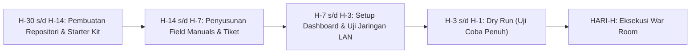

# 📋 Checklist & Todo List Persiapan: Bootcamp Backend Legacy System
> **Nama Program:** *Legacy Code Rescue: E-Commerce Flash Sale War Room*  
> **Format:** Tatap Muka | Solo Engineer | 100% Hands-on | Zero Lecture | PHP 8 + MySQL + Redis

---

## Timeline Ringkas Persiapan

---

## Fase 1: Pengembangan Repositori Starter Kit (`shop-legacy-app`)
*Tenggat Waktu: H-20*

- [ ] **1.1 Setup Arsitektur Docker Compose**
  - [ ] Buat `docker-compose.yml` mencakup: PHP 8.2-FPM, Nginx, MySQL 8.0, dan Redis.
  - [ ] Konfigurasi `nginx.conf` dan `php.ini` (memory limit 512M untuk simulasi load test).
  - [ ] Uji perintah `docker compose up -d` harus berjalan mulus dalam < 3 menit pada instalasi bersih.
- [ ] **1.2 Pengembangan Aplikasi Monolit "TokoLaris" (Sengaja Dibuat Rapuh)**
  - [ ] Buat struktur MVC monolitik dengan controller tebal (`OrderController.php` ~ 1.500 baris).
  - [ ] Suntikkan bug konkurensi stok minus pada method `checkout()`.
  - [ ] Suntikkan masalah N+1 query pada method `listOrders()` (looping query tanpa eager loading).
  - [ ] Suntikkan proses pembuatan PDF invoice synchronous menggunakan FPDF/Dompdf.
  - [ ] Siapkan data pengguna lama dengan format password hashing MD5.
- [ ] **1.3 Database Seeder Realistis**
  - [ ] Buat script seeder database yang menghasilkan minimal **100.000 data transaksi**, 5.000 produk, dan 10.000 pengguna.
  - [ ] Sengaja hapus foreign key index pada tabel `orders` untuk materi optimasi missing index.
- [ ] **1.4 Script Diagnostik Baseline**
  - [ ] Tulis script `bin/baseline-audit.php` yang menjalankan diagnosis awal (menghasilkan skor awal 22/100).
- [ ] **1.5 Branch Solusi Master (Verification Branch)**
  - [ ] Buat branch `solution-master` di mana seluruh 25 tiket + 5 bonus tiket telah diperbaiki.
  - [ ] Pastikan di branch solusi, skor baseline audit mencapai **100/100** dan seluruh test suite hijau.

---

## Fase 2: Pembuatan Automated Test Suites per Tiket
*Tenggat Waktu: H-14*

- [ ] **2.1 Konfigurasi Test Runner (Pest PHP & PHPUnit)**
  - [ ] Install Pest PHP dan plugin snapshot testing.
  - [ ] Setup database testing sementara (*in-memory* SQLite atau database MySQL testing terpisah).
- [ ] **2.2 Pembuatan Test Assertion 25 Tiket**
  - [ ] Buat 25 file test di direktori `tests/Tickets/` (`Tkt01Test.php` s/d `Tkt25Test.php`).
  - [ ] Setiap file wajib memiliki minimal 2 test assertion (untuk mendukung penilaian parsial 50% jika setengah benar).
  - [ ] Pastikan seluruh test berstatus **MERAH (Failed)** pada starter kit awal.
- [ ] **2.3 Script Pengujian Beban (k6)**
  - [ ] Tulis script k6 `load-tests/flash-sale.js` (50 VU serentak).
  - [ ] Tulis script k6 `load-tests/invoice-timeout.js` untuk menguji thread blocking.
  - [ ] Tulis script verifikasi hasil database `tests/verify-flash-sale.php`.

---

## 📚 Fase 3: Penyusunan Dokumen "Field Manual" (Materi Mandiri)
*Tenggat Waktu: H-10*

*Karena tidak ada sesi ceramah, materi harus tersedia mandiri di folder `/docs` dalam repositori:*

- [ ] **3.1 Manual Teknis Pokok**
  - [ ] `docs/manuals/01-concurrency-and-locking.md` (Atomic update, FOR UPDATE, isolation levels).
  - [ ] `docs/manuals/02-database-indexing-and-explain.md` (B-Tree, sargable query, eager loading).
  - [ ] `docs/manuals/03-seam-and-adapter-pattern.md` (Teknik Michael Feathers, wrapper interface).
  - [ ] `docs/manuals/04-async-queue-and-redis.md` (Worker lifecycle, idempotency key).
  - [ ] `docs/manuals/05-security-and-rehash.md` (SQLi prepared statements, IDOR, rehash-on-login).
- [ ] **3.2 Kartu Misi 25 Tiket (`docs/tickets/TKT-XX.md`)**
  - [ ] Setiap tiket memiliki lembar panduan 1 halaman:
    - *Gejala Bug / Permintaan Fitur.*
    - *File yang bersangkutan.*
    - *Command test untuk verifikasi.*
    - *Petunjuk teknis ringkas (Hints).*

---

## 📺 Fase 4: Sistem Pemantauan Progres Instan (Live Scoreboard)
*Tenggat Waktu: H-7*

- [ ] **4.1 Aplikasi Server Dashboard Mentor**
  - [ ] Buat web server mini (Node.js/Express atau PHP + SQLite) dengan tampilan layar penuh untuk proyektor.
  - [ ] Tampilan: Grid nama peserta, nomor meja, status 25 tiket (Abu/Kuning/Hijau), total skor, dan indikator *Stuck Alert* (Merah).
  - [ ] Pasang WebSocket agar layar terupdate seketika (< 100ms) tanpa refresh browser.
- [ ] **4.2 Hook Telemetry di Laptop Peserta**
  - [ ] Sisipkan listener di `tests/Pest.php` starter kit yang otomatis menembak payload HTTP POST ke IP laptop mentor saat test dijalankan.
- [ ] **4.3 Fitur CLI Bantuan ("Call Tech Lead")**
  - [ ] Buat command CLI `php artisan warroom:help "pesan"` yang mengirim notifikasi darurat ke laptop mentor.

---

## 🏢 Fase 5: Logistik Ruangan & Perangkat Keras (Venue Prep)
*Tenggat Waktu: H-3*

- [ ] **5.1 Jaringan Wi-Fi / Router Lokal Ruangan**
  - [ ] Siapkan 1 router Wi-Fi lokal khusus ruangan (tidak perlu internet cepat, yang penting koneksi LAN antar laptop peserta dan laptop mentor stabil).
  - [ ] Pastikan firewall router mengizinkan komunikasi HTTP lokal port 3000 (port dashboard mentor).
  - [ ] Catat IP statis laptop mentor (misal: `192.168.1.10`) dan masukkan sebagai default di file `.env` starter kit peserta.
- [ ] **5.2 Kelistrikan & Tata Ruang**
  - [ ] Pastikan colokan listrik tersedia 1 port per peserta (hindari kabel menumpuk).
  - [ ] Pasang proyektor / monitor besar di depan ruangan dengan resolusi minimal 1080p agar scoreboard terbaca jelas dari meja belakang.
- [ ] **5.3 Backup Paket Offline (USB Flashdisk Darurat)**
  - [ ] Siapkan 2 flashdisk berisi:
    - File installer Docker Desktop (Windows & Mac).
    - File `docker-image-cache.tar` (image PHP, MySQL, Redis) agar peserta yang belum download image bisa import lokal via `docker load`.
    - Zip repositori starter kit lengkap.

---

## 🧪 Fase 6: Dry Run / Gladi Bersih
*Tenggat Waktu: H-2 s/d H-1*

- [ ] **6.1 Simulasi Pengerjaan Penuh (End-to-End Test)**
  - [ ] Mentor atau 1 orang tester mencoba mengerjakan 10 tiket Mudah + Sedang di laptop terpisah.
  - [ ] Pastikan telemetry hook berhasil menembak data ke laptop mentor dan scoreboard proyektor berubah warna seketika.
  - [ ] Uji coba tombol darurat `warroom:help` dan pastikan notifikasi muncul di laptop mentor.
- [ ] **6.2 Validasi Panduan Peserta (Onboarding README)**
  - [ ] Pastikan file `README.md` hanya berisi 3 langkah awal:
    1. Clone repo & copy `.env`.
    2. Jalankan `docker compose up -d`.
    3. Jalankan `php bin/baseline-audit.php` untuk melihat skor awal.

---

## 🚀 Fase 7: Rencana Pelaksanaan Hari-H (Day of Execution)

- [ ] **08.30 – 09.00 | Registrasi & Setup Check**
  - [ ] Peserta menyambungkan laptop ke Wi-Fi lokal ruangan.
  - [ ] Pastikan Docker berjalan di laptop seluruh peserta.
- [ ] **09.00 – 09.20 | Opening Briefing (20 Menit Saja - Tanpa Teori!)**
  - [ ] Perkenalan alur cerita: *"Kalian adalah backend engineer di hari pertama kerja untuk TokoLaris..."*.
  - [ ] Demonstrasi cara membaca scoreboard di proyektor, memilih tiket, dan menjalankan test verifikasi.
  - [ ] Menjalankan bersama perintah `php bin/baseline-audit.php` (melihat skor awal 22/100).
- [ ] **09.20 – 16.30 | The War Room Coding Session**
  - [ ] Peserta mulai membongkar kode dan menyelesaikan tiket secara solo.
  - [ ] Mentor memantau proyektor; mendatangi peserta yang berkedip merah (*stuck > 15m*).
  - [ ] Mengumumkan di ruangan saat ada peserta yang berhasil memecahkan tiket Sulit pertama kali.
- [ ] **16.30 – 17.00 | Closing, Awarding & Portofolio Framing**
  - [ ] Mengumumkan ranking akhir di leaderboard.
  - [ ] Penjelasan 15 menit cara mengonversi tiket-tiket yang diselesaikan hari ini menjadi **cerita STAR Method** di CV dan wawancara kerja teknis.
