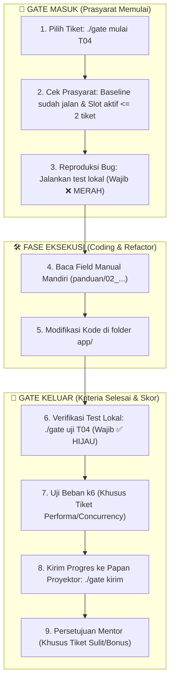

# 🚪 Panduan Sistem Gate Tiket: Tata Tertib & Alur Kerja Pengerjaan

> **Mengapa Perlu Ada Gate?**  
> Di dunia kerja nyata pada sistem legacy, developer tidak boleh asal mengubah kode di *master branch* tanpa disiplin.  
> **Sistem Gate (Gerbang)** memastikan setiap perubahan kode memiliki **hipotesis yang jelas**, **terbukti merah sebelum diperbaiki**, **terverifikasi hijau setelah diubah**, dan **tidak menimbulkan regresi**.

---

## 🔄 Siklus Hidup Pengerjaan Tiket (The Gate Lifecycle)



---

## 📋 Matriks Checklist Gate (Item M & Item K)

### 🚪 Gate Masuk (Prasyarat Sebelum Mengubah Kode)

| Kode Gate | Deskripsi Persyaratan | Verifikator | Keterangan |
| :---: | :--- | :---: | :--- |
| **M1** | **Baseline Terkirim:** Peserta sudah menjalankan `php bin/baseline-audit.php` di awal. | Sistem | Mencegah peserta mulai koding tanpa tahu angka awal sistem. |
| **M2** | **Prasyarat Dependensi:** Tiket fondasi sudah selesai jika tiket memiliki dependensi. | Sistem | Contoh: T06 (N+1) butuh T05 (Index) selesai terlebih dahulu. |
| **M3** | **Batas Work-In-Progress (WIP Limit):** Maksimal **2 tiket aktif** secara bersamaan. | Sistem | Mencegah peserta mengambil semua tiket sekaligus (*multitasking chaos*). |
| **M4** | **Reproduksi Cacat Terbukti:** Peserta menjalankan test dan melihat status **❌ GAGAL**. | Peserta | Menghindari ilusi "bug sudah hilang sendiri". |
| **M5** | **Tiket Bonus Terbuka:** Poin kumulatif peserta sudah mencapai minimal **100 Poin**. | Sistem | Tiket Bonus (*Boss Level*) hanya boleh diambil jika tiket wajib sudah solid. |

---

### 🏁 Gate Keluar (Kriteria Penyelesaian & Klaim Poin)

| Kode Gate | Deskripsi Persyaratan | Verifikator | Keterangan |
| :---: | :--- | :---: | :--- |
| **K1** | **Unit & Feature Test Hijau:** File test tiket bersangkutan menghasilkan status **✅ PASSED**. | Sistem | Syarat mutlak kelulusan fungsional. |
| **K2** | **Zero Regression:** Menjalankan `cek_cepat.php` tidak merusak tiket-tiket yang sudah lulus sebelumnya. | Sistem | Memastikan fix baru tidak mematahkan fitur lama. |
| **K3** | **Uji Beban k6 Lulus (Khusus Tiket Tertentu):** Lolos threshold latensi $p95 < 300\text{ms}$ dan stok pas 0. | Sistem | Berlaku untuk T04 (Flash Sale) dan T15 (PDF Invoice). |
| **K4** | **Telemetri Papan Terupdate:** Perintah `./gate kirim` sukses menembak ke laptop mentor. | Sistem | Poin otomatis terhitung dan warna di proyektor berubah hijau. |
| **K5** | **Tanya Jawab Kilat (2 Menit):** Mampu menjawab 1 pertanyaan konsep dari Tech Lead (Mentor). | Mentor | Berlaku khusus tiket kategori 🔴 **Sulit** dan 🌟 **Bonus**. |

---

## 🔗 Peta Prasyarat Antar-Tiket (Dependency Graph)

Sebagian besar dari 25 tiket dirancang **independen**. Namun, untuk menjaga integritas data sistem, terdapat beberapa prasyarat logis:

```text
[T01: Null Address] -------> Bebas diambil kapan saja (Level Mudah)
[T02: Division by Zero] ---> Bebas diambil kapan saja (Level Mudah)
[T05: Missing Index] ------> Prasyarat wajib sebelum mengerjakan [T06: N+1 Query]
[T04: Concurrency Stok] ---> Prasyarat wajib sebelum mengerjakan [T12: Idempotency Key]
[T13: DTO Email] ----------> Prasyarat wajib sebelum mengerjakan [T14: Redis Queue Email]
[T17: SQL Injection] ------> Bebas diambil kapan saja
[T18: IDOR Invoice] -------> Bebas diambil kapan saja
[T19: Rehash Password] ----> Bebas diambil kapan saja

Semua Tiket Inti (T01 - T25) Selesai / Skor >= 100 Pts ---> Membuka Tiket Bonus [B01 - B05]
```

---

## 🛠️ Perintah Praktis CLI Peserta (`./gate`)

Peserta mengoperasikan seluruh alur gate langsung dari terminal laptopnya:

```bash
# 1. Melihat status seluruh tiket & prasyaratnya
./gate lihat

# 2. Melihat detail checklist gate untuk satu tiket tertentu
./gate lihat T04

# 3. Mengambil tiket (mengaktifkan status WIP)
./gate mulai T04

# 4. Menjalankan pengujian otomatis lokal untuk memverifikasi kodingan
./gate uji T04

# 5. Memverifikasi seluruh sistem cepat (anti-regresi)
./gate cek

# 6. Mengirim klaim poin ke Papan Proyektor Mentor
./gate kirim
```
